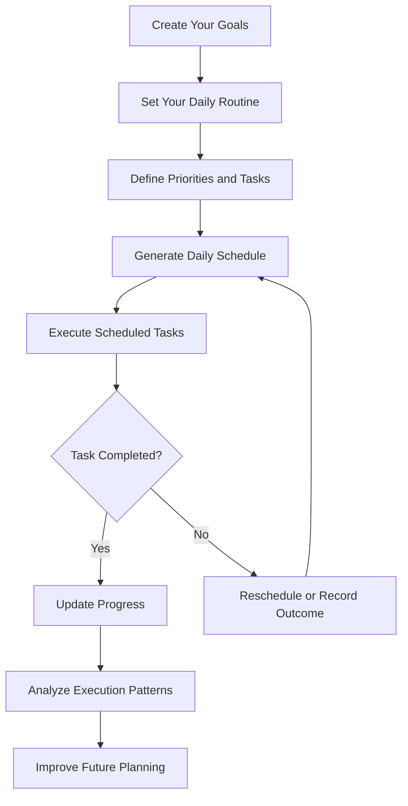
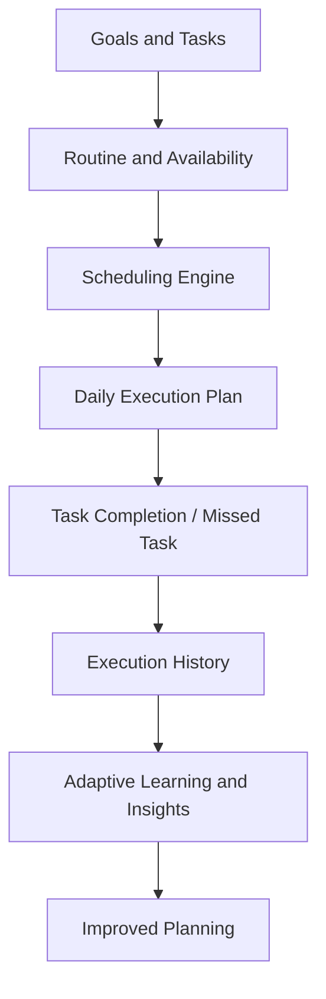
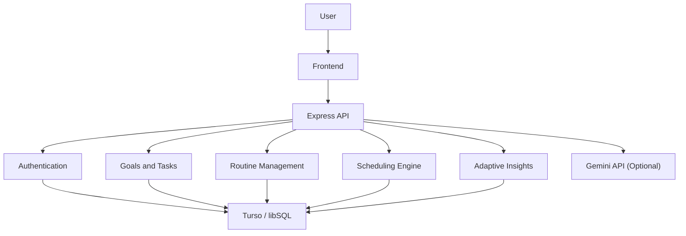

# EKAGRA — One Focus. Many Goals.

<p align="center">
  <strong>A personal execution engine that helps you organize your goals, structure your day, and turn plans into consistent action.</strong>
</p>

<p align="center">
  <a href="https://ekagra-ten.vercel.app/">Live Demo</a> •
  <a href="https://github.com/nk21-dev/EKAGRA">GitHub Repository</a>
</p>

---

## Overview

EKAGRA is a personal goal and routine management application designed to help people manage multiple goals without losing control of their daily schedules.

Instead of simply maintaining a to-do list, EKAGRA connects your goals, daily tasks, available time, and personal routine into one execution system.

It helps you decide what to work on, when to work on it, and how to keep moving when your original plan changes.

**The idea is simple: make progress across multiple goals without making your day unnecessarily complicated.**

## Key Features

### 🎯 Goal Management
- Create and manage multiple personal goals.
- Organize goals using priorities and target dates.
- Break larger goals into manageable daily tasks.
- Track goal progress through completed tasks.

### 🕒 Personalized Daily Routine
- Set up your daily routine across a 24-hour schedule.
- Define activities and available time slots.
- Configure different routines for selected days.
- Use your routine as the foundation for daily scheduling.

### ⚡ Intelligent Scheduling
- Generate schedules around your routine and available time.
- Allocate tasks based on goal priorities and estimated durations.
- Avoid scheduling conflicts and duplicate task allocations.
- Reschedule tasks when plans change.
- Maintain a structured execution plan.

### ✅ Task Execution & Progress
- Complete tasks with a simple check-in.
- Track completed, pending, and missed tasks.
- Keep goal progress derived from actual task completion.
- Record execution outcomes to understand consistency.

### 🧠 Adaptive Insights
- Analyze task execution patterns.
- Build insights from historical activity.
- Understand productivity trends and focus patterns.
- Estimate goal progress using available execution data.

### 🤖 AI-Assisted Duration Estimation
- Use Gemini API integration for AI-assisted task duration estimation.
- Configure your own API key.
- Keep the core goal and scheduling experience usable without AI.

### 🔐 Authentication & Data Management
- User authentication and protected application routes.
- Password hashing for credential security.
- User-specific data management.
- Database-backed storage.

---

## How EKAGRA Works



## Scheduling & Learning Flow

EKAGRA connects planning with actual execution.



The system uses execution history and task outcomes to derive insights and support future planning.

---

## Technology Stack

| Category | Technologies |
|---|---|
| Frontend | HTML, CSS, JavaScript |
| Backend | Node.js, Express.js |
| Database | Turso / libSQL |
| Authentication | JWT, bcrypt |
| AI Integration | Google Gemini API |
| Email | Nodemailer |
| Deployment | Vercel |
| Testing | Node.js Test Runner |

---

## System Architecture



---

## Project Structure

```text
EKAGRA/
│
├── api/
│   └── index.js
│
├── public/
│   └── Frontend assets
│
├── scripts/
│   └── Utility scripts
│
├── server/
│   ├── routes/
│   ├── services/
│   └── Database and backend modules
│
├── tests/
│   └── Application test suites
│
├── .env.example
├── .gitignore
├── app.js
├── index.html
├── package.json
├── package-lock.json
├── style.css
└── vercel.json
```

---

## Getting Started

Follow these steps to run EKAGRA locally.

### Prerequisites

Make sure you have installed:

- [Node.js](https://nodejs.org/)
- npm
- A Turso/libSQL database for remote database configuration, or an appropriate local database configuration.

### 1. Clone the Repository

```bash
git clone https://github.com/nk21-dev/EKAGRA.git
```

### 2. Navigate to the Project

```bash
cd EKAGRA
```

### 3. Install Dependencies

```bash
npm install
```

### 4. Configure Environment Variables

Create a `.env` file in the project root using `.env.example` as a reference.

```bash
cp .env.example .env
```

Configure the required database and authentication values.

Example:

```env
NODE_ENV=development
PORT=3000
APP_URL=http://localhost:3000

JWT_SECRET=your_secure_jwt_secret

TURSO_DATABASE_URL=your_database_url
TURSO_AUTH_TOKEN=your_database_auth_token
```

For optional AI functionality, configure your Gemini API key and the corresponding AI settings.

**Important:** Never commit your `.env` file, database credentials, JWT secrets, or API keys to GitHub.

### 5. Start the Application

```bash
npm run dev
```

For the production start command:

```bash
npm start
```

Open the local application in your browser using the configured local URL.

---

## Running Tests

EKAGRA includes automated tests covering important application workflows.

Run the test suite using:

```bash
npm test
```

The test coverage includes:

- Authentication
- HTTP API behavior
- Goal creation and management
- Goal progress calculation
- Routine setup and coverage
- Task scheduling and synchronization
- Schedule collision and duplicate prevention
- Task completion and rescheduling
- AI duration estimation
- Adaptive learning and insights

---

## Deployment

EKAGRA is deployed using Vercel.

**Live Application:**  
https://ekagra-ten.vercel.app/

To deploy your own instance:

1. Fork or clone this repository.
2. Import the repository into Vercel.
3. Configure the required environment variables.
4. Set up your database credentials.
5. Deploy the application.

Make sure all production secrets and API credentials are configured through Vercel Environment Variables rather than committed files.

---

## Privacy & Security

EKAGRA is designed around user-specific data and secure application access.

- Passwords are hashed before storage.
- Authentication uses JWT-based mechanisms.
- Database credentials are configured through environment variables.
- AI integration is optional.
- Users can provide their own Gemini API key for AI-assisted functionality.

Always use strong secrets and HTTPS in production deployments.

---

## Future Improvements

EKAGRA is an evolving project. Potential areas of further development include:

- More advanced adaptive scheduling.
- Better workload and time-allocation analysis.
- Goal recovery and schedule optimization.
- More detailed productivity insights.
- Improved explainability of scheduling decisions.
- More sophisticated learning models based on execution history.

---

## Contributing

Contributions, suggestions, and feedback are welcome.

If you would like to contribute:

1. Fork the repository.
2. Create a new branch.
3. Make your changes.
4. Test your implementation.
5. Submit a pull request.

Please keep contributions focused, maintainable, and consistent with the existing project architecture.

---

## Project Links

- **Live Demo:** https://ekagra-ten.vercel.app/
- **GitHub:** https://github.com/nk21-dev/EKAGRA

---

<p align="center">
  <strong>EKAGRA</strong>
  <br/>
  One Focus. Many Goals.
  <br/>
  <em>Plan with clarity. Execute with consistency. Grow with purpose.</em>
</p>
